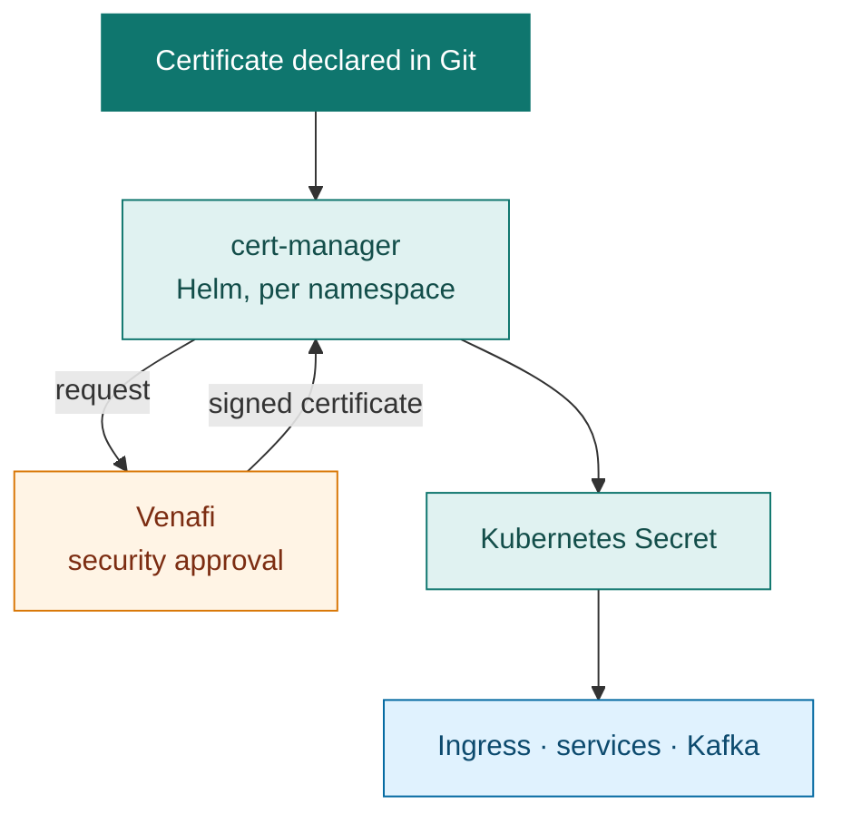
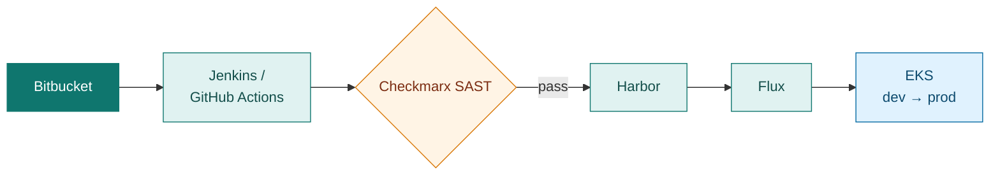
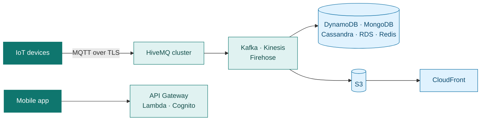

<div align="center">

<picture>
  <source media="(prefers-color-scheme: dark)" srcset="assets/header-dark.svg" />
  <source media="(prefers-color-scheme: light)" srcset="assets/header-light.svg" />
  
</picture>

<a href="https://www.linkedin.com/in/connectchandan"></a> <a href="mailto:chan.upen@gmail.com"></a> <a href="https://www.credly.com/users/chanupen"></a>

<p>
  
  
  
  
  
</p>

</div>

---

```console
$ kubectl describe engineer chandan

Name:          Chandan Kumar
Role:          Senior DevOps / Site Reliability Engineer
Location:      Noida, India (remote or anywhere in India)
Experience:    13+ years in production operations
Current:       adidas, Platform Operations (2022 – present)
Previously:    Hero Electronix / Qubo IoT · UST Global for Bharti Airtel · CSS Corp for AT&T and Juniper
Focus:         AWS · Kubernetes · Terraform · GitOps · Observability · AI for operations
Certs:         AWS Security – Specialty · AWS Solutions Architect – Associate · RHCE · RHCSA
Status:        Ready (open to Senior / Staff DevOps, SRE and Platform roles)
Events:
  Normal  Built     Qubo IoT cloud on AWS, from an empty account to production, solo
  Normal  Scaled    Platform ops across 50+ AWS accounts and 50+ EKS namespaces
  Normal  Saved     ~15% Kubernetes spend, ~20% database spend, ~30% AWS bill
  Normal  Removed   Manual certificate renewals: 100+ certs, zero missed since
```

##  About

I started as a Linux administrator in 2013 and have worked on production systems ever since: telecom production support for Bharti Airtel, the AWS IoT cloud for Hero Group's Qubo, and platform operations at adidas. Titles changed along the way. The job didn't: keep production stable, make releases safe and quick for developers, and get rid of the manual steps that cause outages.

##  Career

| Period | Company | What I did |
| --- | --- | --- |
| 2022 – now | **adidas**, Gurugram | Platform operations for 50+ AWS accounts and 50+ EKS namespaces. Shared CI/CD for 150+ engineers, observability, SLOs and incident RCA, cost work, AI tooling for on-call. Lead a small team of external DevOps and SRE engineers. |
| 2019 – 2022 | **Hero Electronix (Qubo)**, Noida | Designed, built and ran the complete Qubo IoT cloud on AWS on my own and took it live: MQTT at scale, data pipelines, Kubernetes, CI/CD, monitoring. |
| 2015 – 2019 | **UST Global** for Bharti Airtel, Noida | Production support for authentication, KYC, billing, SMS and SIM activation platforms on RHEL. Automation in Python and Bash. |
| 2014 – 2015 | **CSS Corp** for AT&T and Juniper, Chennai | Solaris and Linux production support, P1 incidents on outage bridges. |
| 2013 – 2014 | **KR Network Cloud**, New Delhi | First systems role: Linux servers, NFS, web and mail, Nagios, backups. |

##  Selected work

<details open>
<summary><b>Certificate automation at adidas with cert-manager and Venafi</b></summary>
<br>

100+ TLS, Kafka, ingress and domain certificates across dev, SIT, staging and production used to be requested and renewed by hand, and ops had missed 10–20 renewals over time. Now a team declares a certificate in a file and the platform does the rest. **No missed renewals since.**


</details>

<details open>
<summary><b>Shared CI/CD for 150+ engineers</b></summary>
<br>

Jenkins shared libraries in Groovy and GitHub Actions workflows that developers and QA release through: builds from Bitbucket, Checkmarx SAST as a gate, images in Harbor, Flux for GitOps deploys to EKS. Cut build and test time for a Lerna monorepo **by about half**.


</details>

<details>
<summary><b>Qubo IoT cloud on AWS, built solo</b></summary>
<br>

From an empty AWS account to devices in customers' homes: clustered HiveMQ (MQTT 3.1 and 5) with authentication and authorization; Kafka, Kinesis, Firehose and SQS pipelines; MongoDB, Cassandra, DynamoDB, RDS and Redis; Kubernetes built with kops and kubeadm; blue-green releases; ELK and Prometheus monitoring. Then I ran it: **AWS bill down ~30%** and **broker performance up ~40%** after fixing crypto and code-path issues.


</details>

<details>
<summary><b>AI for operations</b></summary>
<br>

- Shared pipelines that take other teams' AI applications to production on **AWS Bedrock**, using IRSA instead of long-lived AWS keys.
- Internal **MCP servers** for AWS, AWS Knowledge Base, Atlassian and Instana, so on-call engineers get context in one place. MCP also keeps our Confluence docs current.
- **Bedrock RAG** over runbooks and incident history, plus a local RAG stack on **Ollama, FastMCP and ChromaDB**.
- **SmartOps** (internal AI hackathon): one search across Jira and Confluence to find related incidents faster.
</details>

<details>
<summary><b>Cost and observability</b></summary>
<br>

- **Kubernetes spend down ~15%**: right-sized workloads, cluster downscaler, non-production shut down at weekends.
- **RDS, DocumentDB and ElastiCache spend down ~20%**: right-sized instance classes, idle capacity removed.
- **~25% faster issue resolution**: one log format for frontend, backend and platform services in OpenSearch.
- Reworked dashboards and alerts to cut noisy pages; set and report SLOs and MTTR; lead incident RCA and postmortems.
</details>

##  Tools

| Area | |
| --- | --- |
| **Cloud and infrastructure as code** |         |
| **Kubernetes and delivery** |           |
| **Observability** |         |
| **Data and messaging** |         |
| **Security and edge** |        |
| **AI for operations** |      |
| **Languages** |     |

##  Certifications

<p>
  <a href="https://www.credly.com/users/chanupen"></a>
  <a href="https://www.credly.com/users/chanupen"></a>
  
  
</p>

| Certification | Valid |
| --- | --- |
| [AWS Certified Security – Specialty](https://www.credly.com/users/chanupen) | 2026 – 2029 |
| [AWS Certified Solutions Architect – Associate](https://www.credly.com/users/chanupen) | 2024 – 2027 |
| Red Hat Certified Engineer (RHCE) and System Administrator (RHCSA) | 2014 |
| GitOps Fundamentals, Codefresh | 2021 |

##  Working on now

- **Go** for infrastructure tooling and Kubernetes controllers
- **CKA** and **Terraform Associate** exams
- An AI on-call assistant built on MCP and RAG

---

<sub>Most of my production work lives in private company repositories, so public activity here shows only a small part of it. Happy to walk through any of it in detail.</sub>
