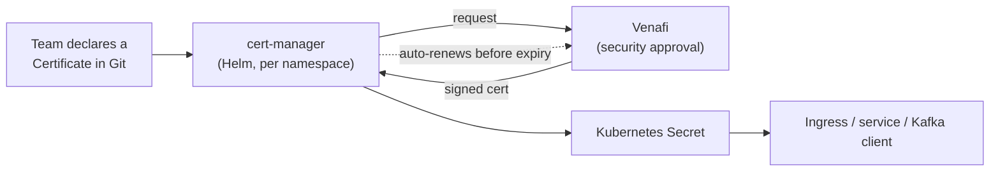
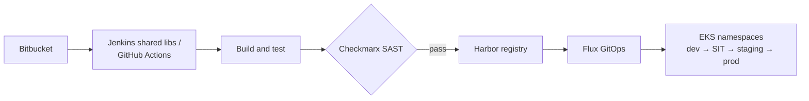
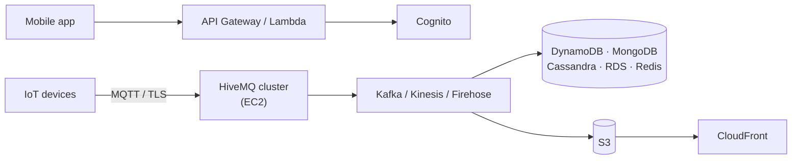

<div align="center">


<p>
  <a href="https://www.linkedin.com/in/connectchandan"></a>
  <a href="mailto:chan.upen@gmail.com"></a>
  <a href="https://www.credly.com/users/chanupen"></a>
</p>

<p>
  
  
  
  
  
  
</p>

</div>

---

```console
$ kubectl describe engineer chandan

Name:          Chandan Kumar
Role:          Senior DevOps / Site Reliability Engineer
Location:      Noida, India (remote or anywhere in India)
Experience:    13+ years in production operations
Current:       adidas, Platform Operations (2022 – present)
Previously:    Hero Electronix / Qubo IoT · UST Global for Bharti Airtel · CSS Corp for AT&T and Juniper
Focus:         AWS · Kubernetes · Terraform · GitOps · Observability · AI for operations
Certs:         AWS Security – Specialty · AWS Solutions Architect – Associate · RHCE · RHCSA
Status:        Ready (open to Senior / Staff DevOps, SRE and Platform roles)
Events:
  Normal  Built     Qubo IoT cloud on AWS, from an empty account to production, solo
  Normal  Scaled    Platform ops across 50+ AWS accounts and 50+ EKS namespaces
  Normal  Saved     ~15% Kubernetes spend, ~20% database spend, ~30% AWS bill
  Normal  Removed   Manual certificate renewals: 100+ certs, zero missed since
```

## About me

I started as a Linux administrator in 2013 and have worked on production systems ever since: telecom production support for Bharti Airtel, the AWS IoT cloud for Hero Group's Qubo, and platform operations at adidas. Titles changed along the way. The job didn't: keep production stable, make releases safe and quick for developers, and get rid of the manual steps that cause outages.

## Career

| Period | Company | What I did |
| --- | --- | --- |
| 2022 – now | **adidas**, Gurugram | Platform operations for 50+ AWS accounts and 50+ EKS namespaces. Shared CI/CD for 150+ engineers, observability, SLOs and incident RCA, cost work, AI tooling for on-call. Lead a small team of external DevOps and SRE engineers. |
| 2019 – 2022 | **Hero Electronix (Qubo)**, Noida | Designed, built and ran the complete Qubo IoT cloud on AWS on my own and took it live. MQTT at scale, data pipelines, Kubernetes, CI/CD, monitoring. |
| 2015 – 2019 | **UST Global** for Bharti Airtel, Noida | Production support for authentication, KYC, billing, SMS and SIM activation platforms on RHEL. Automation in Python and Bash. |
| 2014 – 2015 | **CSS Corp** for AT&T and Juniper, Chennai | Solaris and Linux production support, P1 incidents on outage bridges. |
| 2013 – 2014 | **KR Network Cloud**, New Delhi | First systems role: Linux servers, NFS, web and mail, Nagios, backups. |

## Things I've built

<details open>
<summary><b>🔐 Certificate automation at adidas: cert-manager + Venafi</b></summary>
<br>

100+ TLS, Kafka, ingress and domain certificates across dev, SIT, staging and production used to be requested and renewed by hand. Ops had missed 10–20 renewals over time. Now a team declares a certificate in a file and the platform does the rest. **No missed renewals since.**


</details>

<details open>
<summary><b>🚀 Shared CI/CD for 150+ engineers</b></summary>
<br>

Jenkins shared libraries in Groovy and GitHub Actions workflows that developers and QA release through. Builds from Bitbucket, images in Harbor, Checkmarx SAST as a gate, Flux for GitOps deploys to EKS. Cut build and test time for a Lerna monorepo **by about half**.


</details>

<details>
<summary><b>📡 Qubo IoT cloud on AWS, built solo</b></summary>
<br>

From an empty AWS account to devices in customers' homes. Clustered HiveMQ (MQTT 3.1 and 5) with authentication and authorization, Kafka, Kinesis, Firehose and SQS pipelines, MongoDB, Cassandra, DynamoDB, RDS and Redis, Kubernetes built with kops and kubeadm, blue-green releases, ELK and Prometheus monitoring. Then I ran it: **AWS bill down ~30%**, **broker performance up ~40%** after fixing crypto and code-path issues.


</details>

<details>
<summary><b>🤖 AI for operations</b></summary>
<br>

- Shared pipelines that take other teams' AI applications to production on **AWS Bedrock**, with IRSA instead of long-lived AWS keys.
- Internal **MCP servers** for AWS, AWS Knowledge Base, Atlassian and Instana, so on-call engineers get context in one place. MCP also keeps our Confluence docs up to date.
- **Bedrock RAG** over runbooks and incident history, plus a local RAG stack on **Ollama, FastMCP and ChromaDB**.
- **SmartOps** (internal AI hackathon): one search across Jira and Confluence to find related incidents faster.
</details>

<details>
<summary><b>📉 Cost and observability</b></summary>
<br>

- **Kubernetes spend down ~15%**: right-sized workloads, cluster downscaler, non-production shut down at weekends.
- **RDS, DocumentDB and ElastiCache spend down ~20%**: right-sized instance classes, idle capacity removed.
- **~25% faster issue resolution**: one log format for frontend, backend and platform services in OpenSearch.
- Reworked dashboards and alerts to cut noisy pages; set and report SLOs and MTTR; lead incident RCA and postmortems.
</details>

## Tech stack

**Cloud, containers and infrastructure as code**

<p>
  
</p>

**CI/CD, languages and tooling**

<p>
  
</p>

**Observability and data**

<p>
  
</p>

**Platform, security and AI**

<p>
  
  
  
  
  
  
  
  
  
  
  
  
  
  
  
  
  
  
  
  
  
  
  
  
  
  
  
</p>

## Certifications

<p>
  <a href="https://www.credly.com/users/chanupen"></a>
  <a href="https://www.credly.com/users/chanupen"></a>
</p>
<p>
  
  
</p>

## Working on now

- 🐹 **Go** for infrastructure tooling and Kubernetes controllers
- ☸️ **CKA** and **Terraform Associate** exams
- 🤖 An AI on-call assistant built on MCP and RAG

## GitHub activity

<div align="center">


</div>

> Most of my production work lives in private company repositories, so the public numbers here show only a small part of it. Happy to walk through any of it in detail.

<div align="center">

<sub>Noida, India · <a href="https://www.linkedin.com/in/connectchandan">LinkedIn</a> · <a href="mailto:chan.upen@gmail.com">chan.upen@gmail.com</a></sub>

</div>
